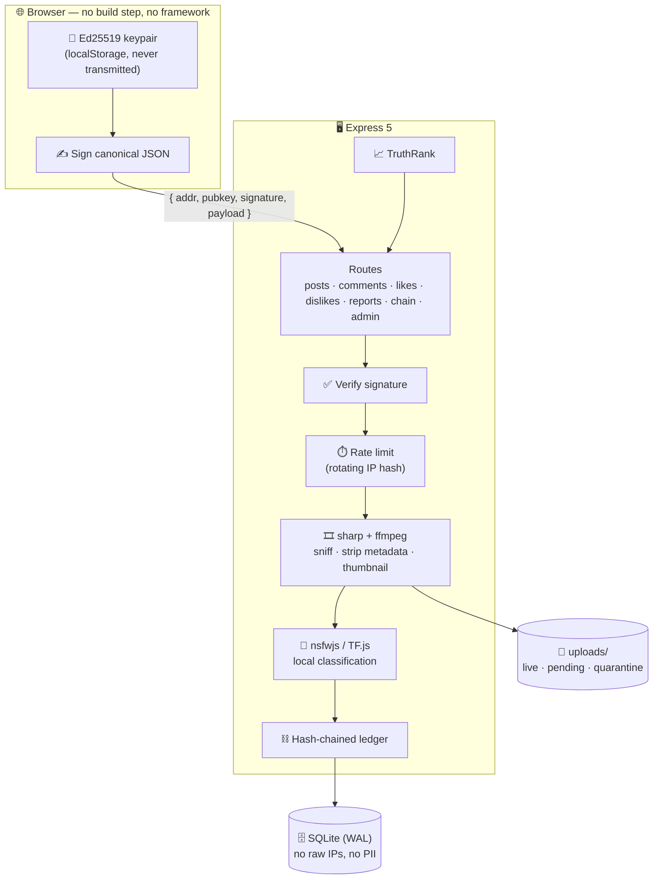

<div align="center">

# 🕶️ gg.share

### Anonymous photo, video & text sharing — with cryptography instead of accounts.

**No email. No phone number. No password. No wallet.**
Your identity is an Ed25519 keypair your browser generates and never sends anywhere.

<p>
  
  
  
  
  
  
</p>

</div>

---

## 🧠 The idea

Every "anonymous" app still makes you sign up for something. gg.share doesn't.

When you first open the site, your browser generates an **Ed25519 keypair** and keeps it
in `localStorage`. Your address is `anon:` + the first 16 chars of base32(SHA-256(public key)).
Every action you take — posting, liking, commenting — is **signed locally** and verified
server-side. The private key never leaves your device. There is nothing to log into,
nothing to leak, and nothing on the server that points back at a real person.

Then every one of those signed actions is appended to a **hash-chained ledger**, so the
history of the site is tamper-evident: change one past row and every hash after it breaks.

```
   ┌───────────┐    ┌───────────┐    ┌───────────┐    ┌───────────┐
   │  genesis  │───▶│  post #1  │───▶│  like #1  │───▶│ comment#1 │───▶ ...
   │  hash: a3 │    │ prev: a3  │    │ prev: 7f  │    │ prev: c2  │
   └───────────┘    │ hash: 7f  │    │ hash: c2  │    │ hash: 91  │
                    └───────────┘    └───────────┘    └───────────┘
        Break any link and GET /api/chain/verify tells you exactly where.
```

---

## 📸 Screenshots

> Drop your captures into `docs/screenshots/` using these filenames and they'll render here.

<div align="center">

|  |  |
|:--:|:--:|
|  |  |
| **The feed** — Latest · Trending · Most liked · Discussed | **Post view** — threaded comments, signed reactions |
|  |  |
| **Your identity** — keypair, address, recovery string | **Moderation queue** — NSFW scores, approve / blacklist |
|  |  |
| **Ledger monitor** — live chain verification | **Dashboard** — storage, security, reputation, audit log |

</div>

---

## ✨ Features

### 🔐 Identity & trust

| | |
|---|---|
| **Zero-signup identity** | Ed25519 keypair generated in-browser. Native WebCrypto where available, vendored `@noble/ed25519` everywhere else. |
| **Signed everything** | Posts, likes, dislikes, comments and reports all carry a signature over canonical JSON. The server verifies before it writes. |
| **Portable via recovery string** | Export `anonkey1:…`, import on another device, keep your address and your history. |
| **Deterministic nicknames** | `anon:k4f2…` always renders as the same *AmberFalcon42* — everywhere, forever, with nothing stored server-side. |
| **Tamper-evident ledger** | Append-only hash chain over every write. Publicly verifiable at `/api/chain/verify`. |

### 🖼️ Content

| | |
|---|---|
| **Media + text posts** | JPEG · PNG · GIF · WebP · MP4 · WebM · MOV, or short text posts with hashtags. |
| **Magic-byte sniffing** | File type is read from the actual bytes — the client's MIME type and extension are never trusted. |
| **Metadata stripped** | Images re-encoded through `sharp` (EXIF/IPTC/XMP/GPS gone); video remuxed with `-map_metadata -1`. |
| **Deduplication** | Content-hash uniqueness means the same file can't be re-uploaded to farm engagement. |
| **Search & tags** | Full-text search, hashtag pages, trending tags — all indexed at write time, no `LIKE` scans. |

### 📈 TruthRank — ranking that resists sockpuppets

Ranking on raw likes is trivially gamed: mint 100 keypairs, like your own post, done.
**TruthRank** weights each voter by the track record their address has actually built here.

```
              likes × 1.0   +   comments × 1.6   +   dislikes × −1.4
  score  =  ─────────────────────────────────────────────────────────  × voterWeight
                        (hours since posted + 2) ^ 1.6
```

- A brand-new address carries **0.25** weight; earning it takes real posts and comments.
- An address with blacklisted posts is weighted **down**, not just ignored.
- Unresolved reports suppress hard (**−3.0**); blacklisting is effectively **−50**.
- Classic Hacker News gravity (`1.6`) keeps a post competitive for about a day.

No external oracle, no on-chain anything — reputation means *what this address has actually done here*.

### 🛡️ Moderation & safety

| | |
|---|---|
| **On-device NSFW detection** | `nsfwjs` MobileNetV2 runs **on your server**. Model weights ship inside the npm package — zero network calls, ever. |
| **Video frame sampling** | Videos are decoded and sampled frame-by-frame, not just thumbnail-checked. |
| **Three-tier outcome** | Over threshold → auto-quarantined. Borderline → held for human review. Clean → live. |
| **Mass-report protection** | A few reports never hide anything — they queue for a human. Only a genuine pile-on (default 40) auto-blacklists. |
| **Quarantine retention** | Blocked media auto-purges from disk after a configurable window. |
| **Redaction without breaking the chain** | Purged media marks its ledger row `redacted` — the row itself is never deleted, so hashes stay intact. |

### 🕵️ Privacy engineering

| | |
|---|---|
| **No raw IP is ever stored** | Rate limiting uses an HMAC-SHA256 of the IP keyed by a salt that **rotates hourly**. The raw address lives for one synchronous computation and is dropped. |
| **Unlinkable over time** | Because the salt rotates, yesterday's hash can't be correlated with today's. |
| **Zero external requests** | No CDNs, no analytics, no third-party fonts, no telemetry. Everything the browser loads comes from your server. |
| **Helmet + strict CSP** | Locked-down headers by default. |
| **Layered rate limits** | Separate budgets for reads, writes, uploads, reports and admin login — all tunable live. |

### 🎛️ Admin panel

Moderation queue with live NSFW scores · mass-report handling · IP-hash and address bans ·
**Ledger Monitor** with one-click chain verification · storage breakdown · security dashboard ·
per-address reputation scoring · analytics · full audit log · hot-reloadable settings
(thresholds, limits, retention) with **no restart required**.

---

## 🏗️ Architecture



---

## 🚀 Getting started

```bash
git clone https://github.com/devil-b0y/gg.share.git
cd gg.share
npm install
cp .env.example .env
```

Fill in `.env` — generate real secrets, don't ship the placeholders:

```bash
node -e "console.log(require('crypto').randomBytes(32).toString('hex'))"
```

| Variable | What it does |
|---|---|
| `PORT` | HTTP listen port (default `3000`) |
| `ADMIN_PASSWORD` | Admin login — hashed into the DB by `npm run setup`, then safe to delete from `.env` |
| `IP_SALT_SEED` | Seeds the hourly-rotating IP-hash salts |
| `SESSION_SECRET` | Signs the admin session cookie |
| `TRUST_PROXY` | Set to `1` behind a reverse proxy so `X-Forwarded-For` is trusted |
| `FORCE_TFJS_CPU` | Force the pure-JS TF backend if the native build misbehaves |

```bash
npm run setup   # verifies the NSFW model loads + hashes your admin password
npm start       # or: npm run dev  (node --watch)
```

| | |
|---|---|
| 🌍 Site | http://localhost:3000 |
| 🛠️ Admin | http://localhost:3000/admin.html |

---

## 🔌 API

<details>
<summary><b>Public endpoints</b></summary>

| Method | Path | Description |
|---|---|---|
| `GET` | `/api/posts` | Feed — supports sort, search, tag and pagination |
| `GET` | `/api/posts/:id` | Single post |
| `GET` | `/api/posts/tags/trending` | Trending hashtags |
| `POST` | `/api/posts` | Upload media (signed, multipart) |
| `POST` | `/api/posts/text` | Create a text post (signed) |
| `GET` | `/api/comments/:postId` | Threaded comments |
| `POST` | `/api/comments` | Add a comment (signed) |
| `POST` | `/api/likes` · `/api/dislikes` | Toggle reaction (signed) |
| `GET` | `/api/likes/:postId/mine` | Your reaction state |
| `POST` | `/api/reports` | Report a post (signed) |
| `GET` | `/api/chain/verify` | **Walk the whole ledger and verify every hash** |

</details>

<details>
<summary><b>Admin endpoints</b> (session-cookie authenticated)</summary>

| Method | Path | Description |
|---|---|---|
| `POST` | `/api/admin/login` · `/logout` | Session management (rate-limited) |
| `GET` | `/api/admin/dashboard` | Headline stats |
| `GET` | `/api/admin/posts` | Moderation queue |
| `POST` | `/api/admin/posts/:id/approve` · `/blacklist` · `/remove` · `/restore` · `/purge` | Moderation actions |
| `GET` | `/api/admin/reports` · `POST /reports/:postId/dismiss` | Report queue |
| `GET` `POST` `DELETE` | `/api/admin/bans` | Ban management |
| `GET` `POST` | `/api/admin/settings` | Live config — no restart needed |
| `GET` | `/api/admin/ledger` · `/chain-verify` | Ledger monitor |
| `GET` | `/api/admin/storage` · `/security` · `/reputation` · `/analytics` · `/audit` | Dashboards |
| `POST` | `/api/admin/purge-sweep` | Force quarantine retention sweep |

</details>

---

## 📂 Project layout

```
server/
  index.js        Express app, helmet/CSP, static + media serving
  config.js       .env  +  hot-reloadable DB-backed settings
  db.js           better-sqlite3 connection (WAL)
  schema.sql      Full schema — annotated, no PII by design
  routes/         One file per API surface
  lib/
    crypto.js     Canonical JSON, SHA-256, signature verification
    ledger.js     ⛓️  Append-only hash chain + verifyChain()
    rank.js       📈  TruthRank scoring
    nsfw.js       🤖  Local NSFW classification
    media.js      🎞️  Magic bytes, metadata stripping, thumbnails
    iphash.js     🕵️  Hourly-rotating salted IP hashing
    queue.js      Async moderation pipeline
    bans.js  ratelimit.js  auth.js  text.js
public/           Vanilla HTML/CSS/JS — no framework, no bundler
scripts/          fetch-model.js · set-admin-password.js
data/             SQLite database        (gitignored)
uploads/          live / pending / quarantine   (gitignored)
```

---

## ⚠️ Before you deploy publicly

> [!WARNING]
> - NSFW detection classifies **adult content**. It is **not** a CSAM detector. Add a real
>   reporting and takedown pipeline before opening this to the public internet.
> - Rotate `ADMIN_PASSWORD`, `IP_SALT_SEED` and `SESSION_SECRET`. The `.env.example` values
>   are placeholders and must never reach production.
> - `data/` and `uploads/` hold user content and are gitignored on purpose — keep it that way.
> - Run behind HTTPS with `TRUST_PROXY` set correctly, or your IP hashing sees your proxy's IP.

---

## 🧰 Stack

**Node.js · Express 5 · SQLite (better-sqlite3, WAL) · vanilla JS** — no framework, no bundler, no build step.
NSFW via **nsfwjs / TensorFlow.js**. Media via **sharp** and **ffmpeg-static**. Crypto via **@noble/ed25519** + WebCrypto.

## 📄 License

[GPL-3.0](LICENSE)

<div align="center">
<sub>Built for people who think anonymity should be a property of the system, not a promise in a privacy policy.</sub>
</div>
